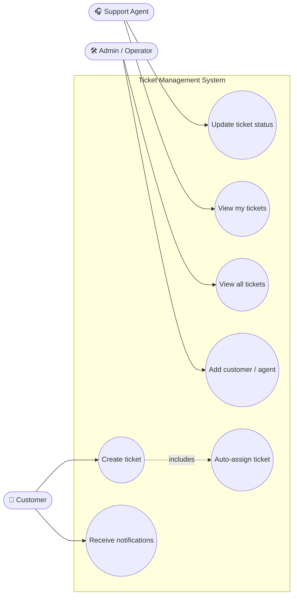
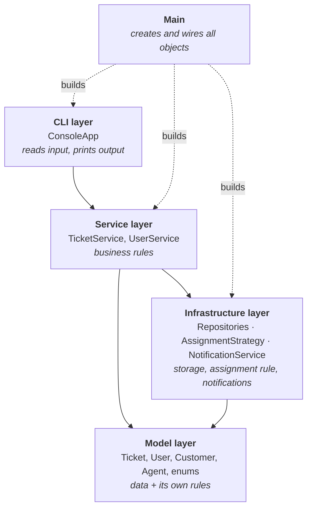
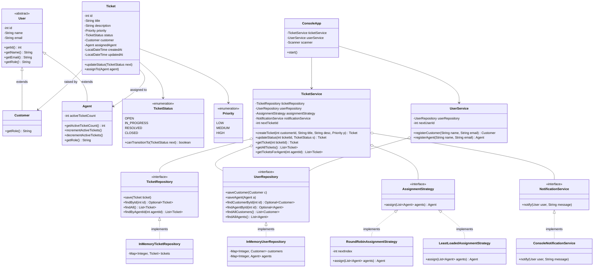
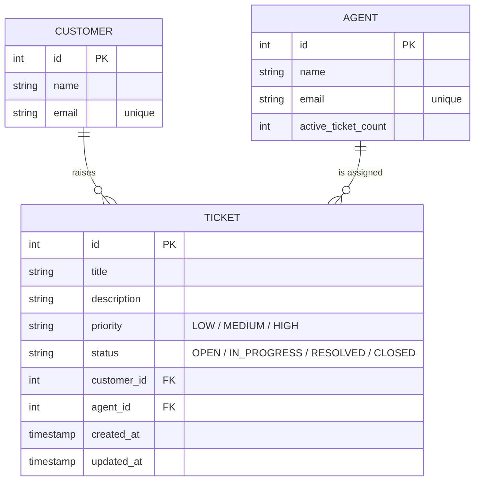
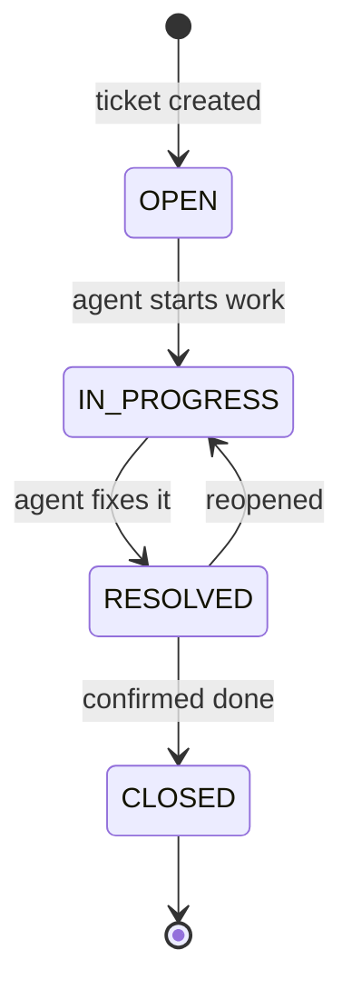
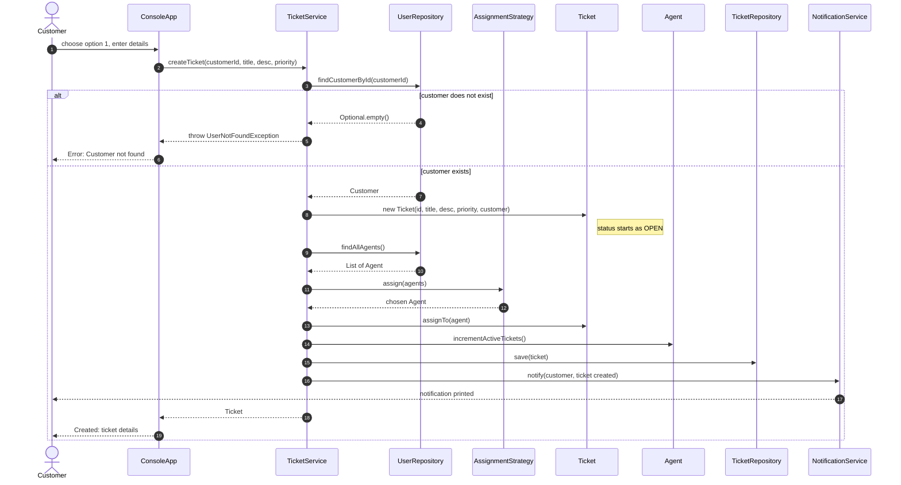
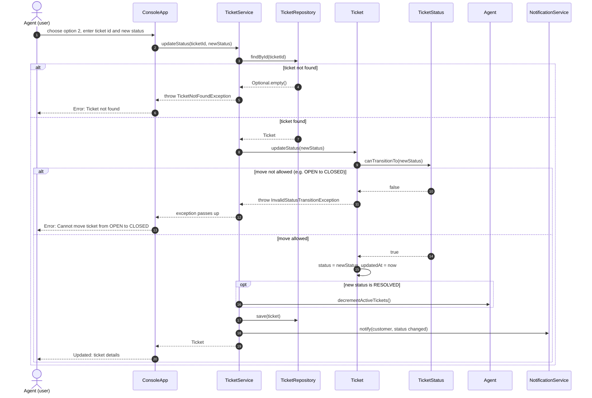
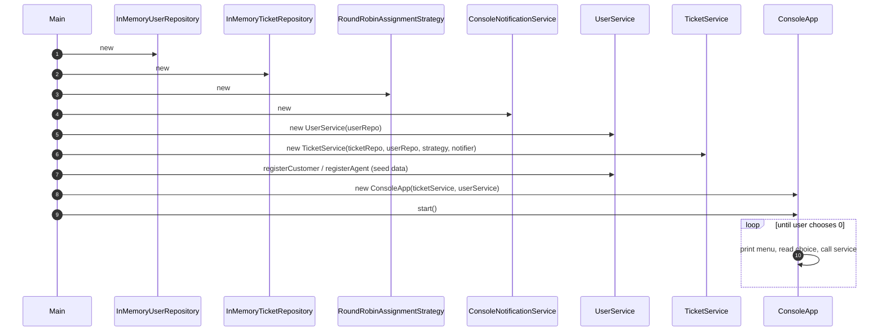
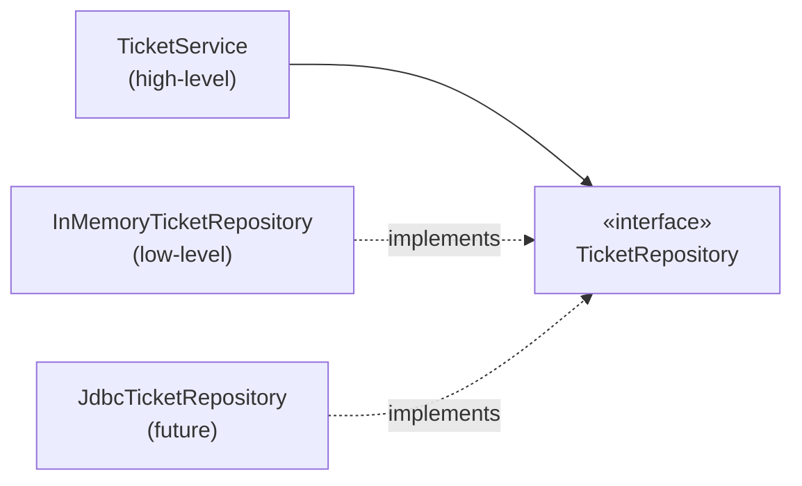
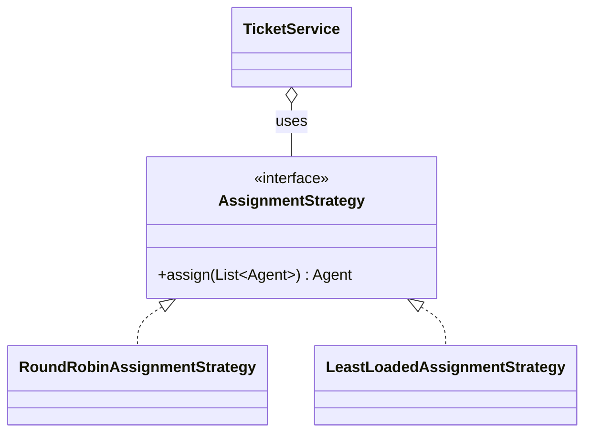

# Ticket Management System

A simple **terminal-based support desk** written in plain Java 17. Customers raise tickets, the system
auto-assigns each ticket to a support agent, and agents move tickets through a fixed lifecycle.

The project is intentionally small. Its purpose is to show **Low-Level Design (LLD)**, **OOP**,
**SOLID principles** and a few **design patterns** in code that is easy to read in one sitting.

> No frameworks, no database, no build tool. Just `javac` and `java`.

---

## Table of Contents

1. [Quick Start](#1-quick-start)
2. [Features](#2-features)
3. [Requirements](#3-requirements)
4. [Use Case Diagram](#4-use-case-diagram)
5. [Architecture (Layers)](#5-architecture-layers)
6. [UML Class Diagram](#6-uml-class-diagram)
7. [ER Diagram (Data Model)](#7-er-diagram-data-model)
8. [State Diagram (Ticket Lifecycle)](#8-state-diagram-ticket-lifecycle)
9. [Sequence Diagrams](#9-sequence-diagrams)
10. [OOP Concepts Used](#10-oop-concepts-used)
11. [SOLID Principles Explained](#11-solid-principles-explained)
12. [Design Patterns Explained](#12-design-patterns-explained)
13. [Other Design Principles](#13-other-design-principles)
14. [Project Structure](#14-project-structure)
15. [Class-by-Class Reference](#15-class-by-class-reference)
16. [Sample Run](#16-sample-run)
17. [Interview Questions](#17-interview-questions)
18. [Exercises and Extensions](#18-exercises-and-extensions)

---

## 1. Quick Start

**Requirement:** Java 17 or newer (`java -version`).

```bash
# compile every .java file into the out/ folder
javac -d out $(find src -name "*.java")

# run the app
java -cp out com.ticketsystem.Main
```

The app starts with sample data so you can try it immediately:

| Id | Name  | Role     |
|----|-------|----------|
| 1  | Rahul | Customer |
| 2  | Priya | Customer |
| 3  | Amit  | Agent    |
| 4  | Neha  | Agent    |

---

## 2. Features

```
1. Create ticket              -> auto-assigned to an agent
2. Update ticket status       -> only valid moves are allowed
3. View all tickets
4. View tickets of an agent
5. List customers and agents
6. Add agent
7. Add customer
0. Exit
```

Every change to a ticket sends a notification to the customer (printed to the console).

---

## 3. Requirements

**Always start an LLD problem by writing down the requirements.** It stops you from over-building
and gives you a checklist to design against.

### Functional requirements (what the system does)

| #  | Requirement |
|----|-------------|
| F1 | Register customers and support agents |
| F2 | A customer can create a ticket with a title, description and priority |
| F3 | A new ticket is automatically assigned to an agent |
| F4 | A ticket moves through `OPEN → IN_PROGRESS → RESOLVED → CLOSED` |
| F5 | Invalid moves are rejected (for example `OPEN → CLOSED`) |
| F6 | View all tickets, or only the tickets of one agent |
| F7 | The customer is notified whenever their ticket changes |

### Non-functional requirements (how well it does it)

| Quality | How this project achieves it |
|---------|------------------------------|
| **Extensible** | Storage, assignment rule and notification channel are interfaces, so new versions plug in without editing old code |
| **Maintainable** | Each class has one job; the layers are clearly separated |
| **Testable** | Business logic depends on interfaces, so fakes can replace real classes in tests |
| **Simple** | In-memory storage, single user, no external dependencies |

### Out of scope

Login and authentication, a real database, multi-threading, SLA timers, comments on tickets.
Naming what you are *not* building is a good habit in interviews.

---

## 4. Use Case Diagram

A use case diagram shows **who** uses the system (actors) and **what** they can do (use cases).



> In this terminal version, one person at the keyboard plays all three roles through the menu.

---

## 5. Architecture (Layers)

The code is split into **layers**. A layer may only call the layer below it, never the one above.



**Why layers?**

- You can replace the console with a REST API by rewriting only the CLI layer.
- You can replace in-memory storage with a database by adding one repository class.
- Business rules live in one place (the service layer), so they are easy to find and test.

---

## 6. UML Class Diagram

A class diagram shows every class, its fields and methods, and how the classes are related.



### How to read the arrows

| Arrow | Name | Meaning | Example here |
|-------|------|---------|--------------|
| `<\|--` (solid, hollow triangle) | **Inheritance** (is-a) | Child class extends parent | `Agent` **is a** `User` |
| `<\|..` (dashed, hollow triangle) | **Realization** | Class implements an interface | `InMemoryTicketRepository` implements `TicketRepository` |
| `o--` (hollow diamond) | **Aggregation** (has-a) | Holds a reference, but the part can live on its own | `TicketService` **has a** `TicketRepository` passed in from outside |
| `*--` (filled diamond) | **Composition** | Part cannot exist without the whole | (not used here; e.g. a `Comment` that belongs only to one `Ticket`) |
| `-->` (plain arrow) | **Association** | One class uses or refers to another | `Ticket` refers to its `Customer` |

### Visibility symbols

`-` private · `+` public · `#` protected · `*` after a method = abstract · `<<interface>>`, `<<abstract>>`, `<<enumeration>>` are **stereotypes** (labels for special kinds of class).

---

## 7. ER Diagram (Data Model)

An Entity-Relationship (ER) diagram describes the **data** and how records relate. The app keeps
data in memory, but this is the schema it would use with a real database.



### How to read it

| Symbol | Meaning |
|--------|---------|
| `PK` | **Primary key**: uniquely identifies a row |
| `FK` | **Foreign key**: points to the primary key of another table |
| `\|\|--o{` | **One-to-many**: exactly one on the left, zero or more on the right |

- **One customer → many tickets.** A customer can raise 0..N tickets; each ticket has exactly one customer.
- **One agent → many tickets.** An agent can work on 0..N tickets; each ticket has one assigned agent.

### Class diagram vs ER diagram

| | Class diagram | ER diagram |
|---|---------------|------------|
| Shows | Objects, **behaviour** (methods), inheritance | **Stored data** only, keys, relationships |
| Inheritance | `Customer` and `Agent` extend `User` | No inheritance; usually two tables (or one `USERS` table with a `role` column) |
| References | `Ticket` holds a `Customer` **object** | `TICKET` holds a `customer_id` **number** |

---

## 8. State Diagram (Ticket Lifecycle)

A state diagram shows the states an object can be in and which moves between them are legal.



### Transition table

| From \ To     | OPEN | IN_PROGRESS | RESOLVED | CLOSED |
|---------------|:----:|:-----------:|:--------:|:------:|
| **OPEN**        | ❌ | ✅ | ❌ | ❌ |
| **IN_PROGRESS** | ❌ | ❌ | ✅ | ❌ |
| **RESOLVED**    | ❌ | ✅ (reopen) | ❌ | ✅ |
| **CLOSED**      | ❌ | ❌ | ❌ | ❌ (final) |

These rules live **inside the enum itself** (`model/TicketStatus.java`):

```java
public boolean canTransitionTo(TicketStatus next) {
    switch (this) {
        case OPEN:        return next == IN_PROGRESS;
        case IN_PROGRESS: return next == RESOLVED;
        case RESOLVED:    return next == CLOSED || next == IN_PROGRESS;
        case CLOSED:
        default:          return false;
    }
}
```

And the only way to change a ticket's status is through `Ticket.updateStatus()`, which checks the rule first:

```java
public void updateStatus(TicketStatus next) {
    if (!status.canTransitionTo(next)) {
        throw new InvalidStatusTransitionException(status, next);
    }
    this.status = next;
    this.updatedAt = LocalDateTime.now();
}
```

**Side effect on the agent's workload:** moving to `RESOLVED` lowers the agent's active-ticket count,
and reopening (`RESOLVED → IN_PROGRESS`) raises it again.

---

## 9. Sequence Diagrams

A sequence diagram shows **which object calls which, in what order**, for one scenario.
Time flows from top to bottom. Solid arrows are calls; dashed arrows are return values.

### 9.1 Create a ticket



**Things to notice:**

- `TicketService` talks only to **interfaces** (`UserRepository`, `AssignmentStrategy`, ...). It has no idea the data is in a `HashMap` or that agents are picked round-robin.
- Errors are **thrown** by the service and **caught and printed** by `ConsoleApp`.

### 9.2 Update a ticket's status



### 9.3 Application start-up (wiring)



`Main` is the **composition root**: the only place that names concrete classes. Everything else
receives its dependencies through the constructor.

---

## 10. OOP Concepts Used

### 10.1 Encapsulation: hide the data, expose safe operations

Fields are `private`. Outside code cannot set `ticket.status = CLOSED` directly; it must call
`updateStatus()`, which enforces the rules.

```java
public class Ticket {
    private TicketStatus status;          // hidden

    public void updateStatus(TicketStatus next) { ... }   // the only door in
}
```

**Benefit:** the object can never get into an invalid state.

### 10.2 Abstraction: show what something does, hide how

`TicketService` sees `AssignmentStrategy.assign(agents)`. It doesn't know (or care) whether that is
round-robin, least-loaded, or random.

### 10.3 Inheritance: share common code through an "is-a" relationship

```java
public abstract class User { id, name, email ... }
public class Customer extends User { ... }
public class Agent    extends User { activeTicketCount ... }
```

`id`, `name` and `email` are written once in `User`. `User` is **abstract** because a plain "user"
never exists on its own; it is always a customer or an agent.

### 10.4 Polymorphism: one call, different behaviour

```java
User user = new Agent(...);
user.getRole();   // "Agent"   — decided at runtime
```

The same happens with interfaces: `assignmentStrategy.assign(...)` runs whichever implementation
`Main` plugged in. This is **runtime polymorphism** (method overriding).

### 10.5 Enums with behaviour

Java enums are full classes. `TicketStatus` holds data (the constants) **and** behaviour
(`canTransitionTo`). This is safer than strings: `"CLOSD"` compiles, `TicketStatus.CLOSD` doesn't.

### 10.6 Custom exceptions

| Exception | Thrown when |
|-----------|-------------|
| `TicketNotFoundException` | No ticket with that id |
| `UserNotFoundException` | No customer/agent with that id |
| `InvalidStatusTransitionException` | Illegal status move |

They extend `RuntimeException` (unchecked), so callers aren't forced to write `try/catch` everywhere.
`ConsoleApp` catches them in **one place** and prints a friendly message.

---

## 11. SOLID Principles Explained

SOLID is five guidelines that make code easy to change without breaking it.

### S: Single Responsibility Principle

> *A class should have only one reason to change.*

| Class | Its single job | It changes only when... |
|-------|----------------|-------------------------|
| `ConsoleApp` | Read input, print output | The UI changes |
| `TicketService` | Ticket business rules | The rules change |
| `InMemoryTicketRepository` | Store and fetch tickets | Storage changes |
| `ConsoleNotificationService` | Deliver a message | The channel changes |
| `Main` | Create and connect objects | Wiring changes |

❌ **Violation would look like:** `TicketService` printing menus *and* storing data in its own `HashMap` *and* writing emails.

### O: Open/Closed Principle

> *Open for extension, closed for modification.*

Want a new way to assign tickets? **Add a class.** Don't touch `TicketService`.

```java
public class LeastLoadedAssignmentStrategy implements AssignmentStrategy {
    public Agent assign(List<Agent> agents) { ... }
}
```

Then change one line in `Main`:

```java
AssignmentStrategy assignmentStrategy = new LeastLoadedAssignmentStrategy();
```

❌ **Violation would look like:** an `if (mode.equals("roundRobin")) ... else if (mode.equals("leastLoaded")) ...` inside `TicketService` that grows every time.

### L: Liskov Substitution Principle

> *A subclass must be usable anywhere its parent is expected, without surprises.*

- Any `Customer` or `Agent` can be passed to `NotificationService.notify(User user, ...)`, and it works.
- Any `TicketRepository` implementation can be handed to `TicketService`, and the service behaves correctly.

❌ **Violation would look like:** a `ReadOnlyTicketRepository` whose `save()` throws an exception. Code expecting a normal repository would break.

### I: Interface Segregation Principle

> *Many small, focused interfaces are better than one big one.*

- `NotificationService` has **one** method.
- `AssignmentStrategy` has **one** method.
- Ticket storage and user storage are **separate** interfaces.

❌ **Violation would look like:** one giant `TicketSystemOperations` interface with 20 methods, where an SMS notifier is forced to implement `findByAgentId()`.

### D: Dependency Inversion Principle

> *High-level code should depend on abstractions, not on concrete classes.*

```java
// TicketService depends on INTERFACES...
public TicketService(TicketRepository ticketRepository,
                     UserRepository userRepository,
                     AssignmentStrategy assignmentStrategy,
                     NotificationService notificationService) { ... }
```



Both the high-level service and the low-level storage depend on the **interface** in the middle.
The dependency arrow is "inverted": storage points up to the abstraction instead of the service pointing down to storage.

❌ **Violation would look like:** `private InMemoryTicketRepository repo = new InMemoryTicketRepository();` inside `TicketService`.

---

## 12. Design Patterns Explained

### 12.1 Strategy pattern

**Problem:** the rule for picking an agent may change (round-robin today, least-loaded tomorrow).
**Solution:** put each rule in its own class behind a common interface, and let the caller choose one.



| Role in the pattern | Class here |
|---------------------|------------|
| Context | `TicketService` |
| Strategy interface | `AssignmentStrategy` |
| Concrete strategies | `RoundRobinAssignmentStrategy`, `LeastLoadedAssignmentStrategy` |

### 12.2 Repository pattern

**Problem:** business code shouldn't care whether data lives in a `HashMap`, a file or PostgreSQL.
**Solution:** a repository interface offers collection-like methods (`save`, `findById`, `findAll`);
the storage details hide behind it.

Swapping to a database = write `JdbcTicketRepository implements TicketRepository`. Nothing else changes.

### 12.3 Observer pattern (simplified)

**Problem:** when a ticket changes, someone must be told, but the ticket logic shouldn't know *how* (console, email, SMS).
**Solution:** the service calls `notificationService.notify(...)` after every change; the notifier decides the channel.

A full Observer would keep a **list** of listeners (`List<NotificationService>`) and notify all of
them. That is a natural next step (see [Exercises](#18-exercises-and-extensions)).

### 12.4 State pattern (lightweight)

**Problem:** a ticket's allowed actions depend on its current state.
**Solution:** each state (enum constant) knows its own valid next states via `canTransitionTo()`.

The "full" State pattern makes one class per state (`OpenState`, `InProgressState`, ...). With only
four simple states, an enum is the **KISS** version of the same idea.

### 12.5 Dependency Injection (manual)

Objects don't create their own dependencies; they **receive** them through the constructor.
`Main` builds everything and passes it in. Frameworks like **Spring** do exactly this automatically.

---

## 13. Other Design Principles

| Principle | Meaning | Where in the code |
|-----------|---------|-------------------|
| **DRY** (Don't Repeat Yourself) | Write each piece of knowledge once | `id/name/email` live only in `User`; transition rules only in `TicketStatus` |
| **KISS** (Keep It Simple, Stupid) | Prefer the simplest thing that works | Enum instead of a full State class hierarchy; in-memory maps instead of a DB |
| **YAGNI** (You Aren't Gonna Need It) | Don't build features before you need them | No auth, no threads, no persistence yet |
| **Composition over Inheritance** | Build behaviour by combining objects, not extending classes | `TicketService` *has* a strategy, repo and notifier; it extends nothing |
| **Fail Fast** | Detect errors as early as possible, loudly | Invalid ids and moves throw immediately instead of returning `null` |
| **Tell, Don't Ask** | Tell an object to do something instead of pulling its data and deciding for it | `ticket.updateStatus(next)` rather than the service checking `ticket.getStatus()` itself |
| **Separation of Concerns** | Different concerns in different places | UI / business / storage in separate layers |
| **Program to an interface** | Declare variables by interface type | `TicketRepository repo = new InMemoryTicketRepository();` in `Main` |

---

## 14. Project Structure

```
ticket-management-system/
├── README.md                         ← you are here
├── PLAN.md                           ← design notes written before coding
└── src/com/ticketsystem/
    ├── Main.java                     ← composition root (wiring)
    ├── cli/
    │   └── ConsoleApp.java           ← menu loop, input/output
    ├── service/
    │   ├── TicketService.java        ← ticket business rules
    │   └── UserService.java          ← register customers/agents
    ├── repository/
    │   ├── TicketRepository.java     ← interface
    │   ├── InMemoryTicketRepository.java
    │   ├── UserRepository.java       ← interface
    │   └── InMemoryUserRepository.java
    ├── strategy/
    │   ├── AssignmentStrategy.java   ← interface
    │   ├── RoundRobinAssignmentStrategy.java
    │   └── LeastLoadedAssignmentStrategy.java  ← exercise (TODO)
    ├── notification/
    │   ├── NotificationService.java  ← interface
    │   └── ConsoleNotificationService.java
    ├── model/
    │   ├── User.java                 ← abstract
    │   ├── Customer.java
    │   ├── Agent.java
    │   ├── Ticket.java
    │   ├── TicketStatus.java         ← enum + transition rules
    │   └── Priority.java             ← enum
    └── exception/
        ├── TicketNotFoundException.java
        ├── UserNotFoundException.java
        └── InvalidStatusTransitionException.java
```

**Suggested reading order:** `model/` → `repository/` → `strategy/` → `service/TicketService.java` → `Main.java` → `cli/ConsoleApp.java`.

---

## 15. Class-by-Class Reference

| Class | Package | Type | Responsibility | Key concept |
|-------|---------|------|----------------|-------------|
| `User` | model | abstract class | Shared id, name, email | Abstraction, inheritance |
| `Customer` | model | class | A person who raises tickets | Inheritance |
| `Agent` | model | class | Works on tickets, tracks workload | Inheritance, encapsulation |
| `Ticket` | model | class | Ticket data + guarded status changes | Encapsulation |
| `TicketStatus` | model | enum | Lifecycle states + allowed moves | State pattern (light) |
| `Priority` | model | enum | LOW / MEDIUM / HIGH | Type safety |
| `TicketRepository` | repository | interface | Ticket storage contract | Repository, DIP |
| `InMemoryTicketRepository` | repository | class | Stores tickets in a `LinkedHashMap` | Realization |
| `UserRepository` | repository | interface | User storage contract | Repository, ISP |
| `InMemoryUserRepository` | repository | class | Stores users in two maps | Realization |
| `AssignmentStrategy` | strategy | interface | "Pick an agent" contract | Strategy, OCP |
| `RoundRobinAssignmentStrategy` | strategy | class | Agents in turn: A, B, A, B... | Strategy |
| `LeastLoadedAssignmentStrategy` | strategy | class | Agent with fewest active tickets | OCP (exercise) |
| `NotificationService` | notification | interface | "Tell a user something" contract | Observer, ISP |
| `ConsoleNotificationService` | notification | class | Prints notifications | Realization |
| `TicketService` | service | class | Create, assign, update, query tickets | SRP, DIP, composition |
| `UserService` | service | class | Register and list users | SRP |
| `ConsoleApp` | cli | class | Menu + input validation | SRP, separation of concerns |
| `Main` | root | class | Builds and wires everything | Dependency injection |

---

## 16. Sample Run

```
=== Ticket Management System ===
Choose an option: 1
Customer id: 1
Title: Login not working
Description: Cannot login since morning
Priority (LOW/MEDIUM/HIGH): high
  [notify -> rahul@mail.com] Ticket #1 created and assigned to Amit
Created: #1   Login not working   HIGH   OPEN   customer: Rahul   agent: Amit

Choose an option: 2
Ticket id: 1
Current status: OPEN
New status (OPEN/IN_PROGRESS/RESOLVED/CLOSED): CLOSED
Error: Cannot move ticket from OPEN to CLOSED

Choose an option: 2
Ticket id: 1
Current status: OPEN
New status (OPEN/IN_PROGRESS/RESOLVED/CLOSED): IN_PROGRESS
  [notify -> rahul@mail.com] Ticket #1 moved from OPEN to IN_PROGRESS
Updated: #1   Login not working   HIGH   IN_PROGRESS   customer: Rahul   agent: Amit
```

---

## 17. Interview Questions

<details>
<summary><b>Why is TicketStatus an enum with logic instead of a String?</b></summary>

Type safety (typos don't compile) and the transition rules live in exactly one place next to the
data they describe.
</details>

<details>
<summary><b>How would you add email notifications?</b></summary>

Create `EmailNotificationService implements NotificationService` and change one line in `Main`.
`TicketService` is untouched (Open/Closed + Dependency Inversion).
</details>

<details>
<summary><b>How would you move to a real database?</b></summary>

Write `JdbcTicketRepository implements TicketRepository` (and one for users). Use the tables from
the ER diagram. Swap it in `Main`. No service code changes.
</details>

<details>
<summary><b>How would you make it thread-safe for many users?</b></summary>

Use `ConcurrentHashMap` in repositories, `AtomicInteger` for id counters, make the round-robin index
atomic, and make "pick agent + increment workload + save" a single synchronized/transactional step
so two tickets can't race for the same slot.
</details>

<details>
<summary><b>Why is User abstract and not an interface?</b></summary>

`User` shares **state** (id, name, email) and code, not just method signatures. Abstract classes can
hold fields and constructors; interfaces can't hold instance state.
</details>

<details>
<summary><b>Aggregation vs composition: which is TicketService → TicketRepository?</b></summary>

Aggregation. The repository is created outside (in `Main`) and passed in; it could be shared with
other services and lives independently of `TicketService`.
</details>

<details>
<summary><b>Where would you add SLA / escalation?</b></summary>

Add an `EscalationPolicy` interface (e.g. "HIGH tickets open > 2h get reassigned") and a scheduler
that checks tickets periodically. Existing classes stay closed for modification.
</details>

<details>
<summary><b>Why throw exceptions instead of returning null?</b></summary>

Fail fast. A `null` travels silently until something crashes far away with a confusing
`NullPointerException`. An exception names the real problem at the place it happened.
</details>

---

## 18. Exercises and Extensions

Ordered from easiest to hardest:

1. **Least-loaded assignment.** Finish `LeastLoadedAssignmentStrategy` (look for `TODO(human)`) and switch to it in `Main`.
2. **Priority-based assignment.** HIGH tickets go only to agents marked `senior`.
3. **Multiple notifiers.** Hold a `List<NotificationService>` and notify all of them (full Observer).
4. **Search.** Filter tickets by status or priority.
5. **Comments.** Add `List<Comment>` to `Ticket` (a true **composition** relationship).
6. **Persistence.** `CsvTicketRepository` that saves to and loads from a file.
7. **Unit tests.** JUnit tests for `TicketStatus.canTransitionTo` and `TicketService` using fake repositories.
